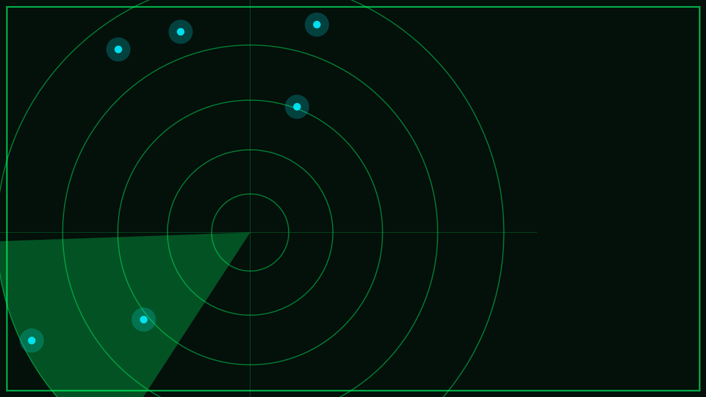

# ZEICHEN, DIE SICH ORDNEN

Ihr habt **Teil 2 von 6** der Festplatte gefunden. Das Handy zeigt immer öfter dieselben Zeichen, und langsam ordnen sie sich: Es sind **Bruchstücke von Wörtern**.

Auch dieser Ort erzählt etwas – ein weiteres Kunstwerk, an dem ihr nicht einfach vorbeigehen solltet. Die Aliens sammeln Eindrücke von den Dingen, die Menschen gebaut haben.

Ihr seid auf der richtigen Fährte.
