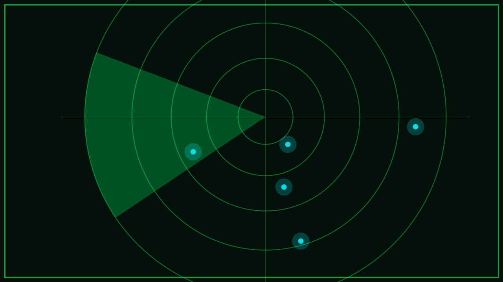

# EINE STERNKARTE

Hier liegt kein UFO. Das Signal kommt von etwas ganz anderem: von einer **Sternkarte** – einem öffentlichen Kunstobjekt, einem **Relikt**, das vor langer Zeit hier aufgestellt wurde.

Die Aliens haben die Karte sofort erkannt. Sie ist **veraltet**: Die Sterne haben sich verschoben, und für den Heimflug brauchen die Aliens eine **aktuelle Route**.
