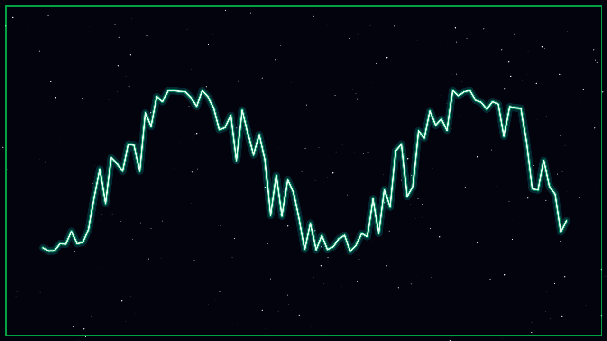

# SIMULATION ERFOLGREICH

Die Route ist frei – kein Komet, kein Asteroid im Weg. Die Aliens speichern sie in ihrer Sternkarte ab.

Doch noch können sie nicht losfliegen: Die **anderen Aliens im All** müssen die neue Route erst bekommen. Dafür braucht ihr einen **starken Sender**.

Das Handy zeigt euch den Weg dorthin.
