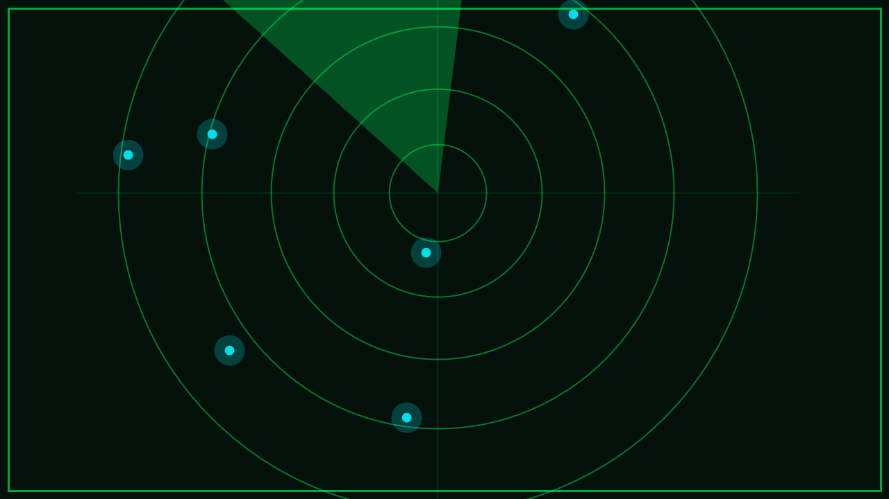

# DAS HANDY MELDET SICH

In **Singen am Hohentwiel** sind mehrere **UFOs abgestürzt**. Ihr seid das **Forschungsteam**, das man angeheuert hat, den Spuren nachzugehen – und ihr seid schon mittendrin.

Auf eurer Suche habt ihr ein **fremdartiges Handy** gefunden. Es zeigt Zeichen, die kein Mensch lesen kann. Sprechen könnt ihr mit den Aliens nicht, aber ihr empfangt ihre Signale – und sie spüren, dass jemand zuhört.

Gerade hat das Handy zum ersten Mal in dieser Stadt kräftig vibriert: Ein Signal ist ganz in der Nähe.

Das Navigationssystem der Aliens ist kaputt, sie finden nicht mehr nach Hause. Folgt dem Signal und helft ihnen.

> Ab jetzt zählt jede Spur. Haltet die Augen offen!
