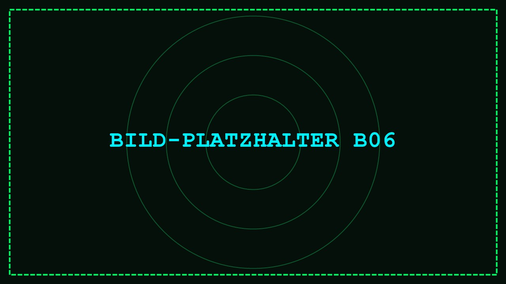

# STÖRSENDER ABGESCHALTET

*[TEXT-PLATZHALTER T06]*

Die Sperre ist geknackt, der Störsender ist **abgeschaltet**. Das Signal ist wieder frei.

Platzhaltertext: Hier erzählt die Geschichte weiter, was durch den abgeschalteten Störsender passiert.
